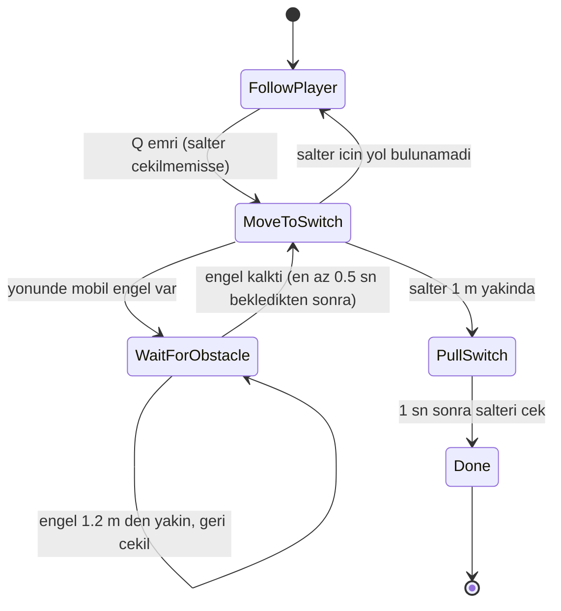
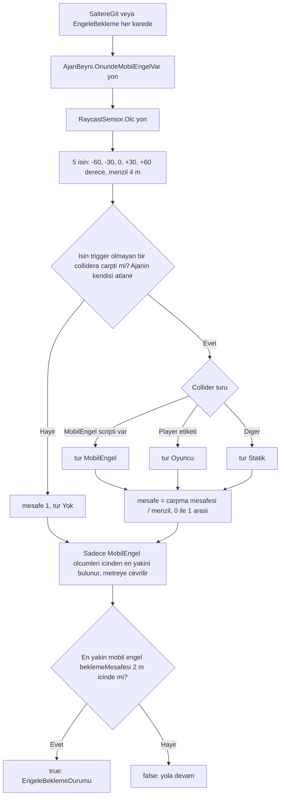

# MüzeSoygunu

Kocaeli Üniversitesi BSM · Yazılım Geliştirme Laboratuvarı-I · Proje-1

Unity 6.3 LTS (6000.3.25f1) · 2D Built-in RP · yeni Input System

**Ekip:** Ceren Alsan ([@cerenalsan](https://github.com/cerenalsan)) · Zeynep Umutlu ([@ZeynepUmutlu](https://github.com/ZeynepUmutlu))

Müzeye giren bir hırsızı oynarsın. NavMesh üzerinde hareket eden bir yardımcı ajanla şalteri çekip lazerleri kapatır, elması alır ve çıkışta yerel bir LLM ile konuşan güvenlik görevlisini ikna etmeye çalışırsın.

## 1. Proje Özeti ve Kurulum

<!-- Sahibi: Ceren + Zeynep -->

_Yazılacak: oyunun akışı, gerekli yazılımlar (Unity sürümü, Ollama), çalıştırma adımları._

## 2. Ajan Mimarisi

<!-- Sahibi: Ceren -->

### 2.1 Durum Diyagramı

Ajan (`AjanBeyni`) State Pattern ile çalışır. Her durum `IAjanDurumu` arayüzünü gerçekler (`Gir`, `Guncelle`, `Cik`, `EmirAlindi`). Durum geçişleri `DurumDegistir` üzerinden yapılır ve her geçiş konsola `[Ajan] eski -> yeni` olarak yazılır.

| Durum | Log adı | Davranış |
|---|---|---|
| `OyuncuyuTakipDurumu` | `FollowPlayer` | Oyuncu 2 m'den uzaksa NavMesh ile oyuncuya gider, yakınsa durur |
| `SaltereGitDurumu` | `MoveToSwitch` | Şaltere yürür, her karede önünü sensörle tarar |
| `EngeleBeklemeDurumu` | `WaitForObstacle` | Mobil engel varken durur, engel 1.2 m'den yakınsa 1.5 birim geri çekilir |
| `SalteriCekDurumu` | `PullSwitch` | 1 sn bekler, `Salter.Interact()` çağırır |
| `BittiDurumu` | `Done` | Görev bitti, hiçbir şey yapmaz |

### 2.2 Sensör ve Algı

Algı katmanı `ISensor` arayüzü arkasındadır. `RaycastSensor`, ajanın gidiş yönüne göre yelpaze şeklinde 5 ışın atar ve her ışın için bir `SensorOlcumu` üretir (açı, normalize mesafe, tür). Karar mantığı `AjanBeyni.OnundeMobilEngelVar` içindedir; ajan sadece mobil engelleri dikkate alır.

| Sınıf | Rol |
|---|---|
| `ISensor` | `Olc(yon)` ile ölçüm listesi döner, test için sahte (fake) sensör verilebilir |
| `RaycastSensor` | Fizik tabanlı gerçek sensör, 5 ışın, trigger collider'ları yok sayar |
| `SensorOlcumu` | Değişmez veri: açı, normalize mesafe, `AlgilananTur` |
| `AlgilananTur` | `Yok`, `Statik`, `MobilEngel`, `Oyuncu` |

### 2.3 Parametreler

_(parametre tablosu buraya)_

### 2.4 Sınıf Diyagramı ve SOLID

_(sınıf diyagramı buraya)_

## 3. LLM Güvenlik NPC

<!-- Sahibi: Zeynep -->

_Zeynep dolduracak: model seçimi, prompt, JSON sözleşmesi, hata yönetimi._

## 4. Oyun Akışı ve Sahneler

<!-- Sahibi: Ceren + Zeynep -->

_Yazılacak: aşamalar (GameStage), sahne geçişleri, ortak sözleşme (Scripts/Shared)._

## 5. Testler

<!-- Sahibi: Ceren (5.2), Zeynep (5.1) -->

### 5.1 NPC Testleri

_Zeynep dolduracak._

### 5.2 Ajan Testleri

_(birim testleri buraya)_

## 6. Riskler ve Ekip Çalışması

<!-- Sahibi: Ceren + Zeynep -->

Riskler: [docs/risk-notlari.md](docs/risk-notlari.md) · Kararlar: [docs/kararlar.md](docs/kararlar.md)

_Yazılacak: commit/PR akışı, kullanılan görseller ([ASSETS.md](ASSETS.md))._

