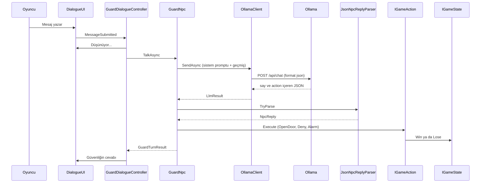

Güvenlik görevlisi Kemal, yerel Ollama üzerinde çalışan `gemma3:4b` modeliyle konuşur. Bulut API'si kullanılmaz.

### Model seçimi ve gerekçesi

Demo makinesinde 6 GB VRAM'li bir ekran kartı var. Seçim kriterleri belleğe sığma ve cevap süresi oldu. `gemma3:4b` modeli `ollama ps` çıktısında `100% GPU` gösterdi ve Türkçe duman testinde hatasızdı. Önceki model `gemma2:2b` güvenlik görevlisinde Türkçe kelime ve cümle hataları yapıyordu. `gemma4:e4b` aynı donanımda oyun için fazla yavaş çıktığından elendi. Ayrıntılı ölçümler: [docs/model-secimi.md](docs/model-secimi.md), ham cevaplar: `docs/model-testi/`.

Model adı `Assets/_Project/Scripts/Zeynep/LlmSettings.asset` içindeki `modelName` alanından okunur. Başka bir modele geçmek için yalnızca bu alan değişir.

### Sistem promptu (v1)

Kişilik ve amaç: gece müzenin çıkış kapısında nöbet tutan şüpheci ama adil bir güvenlik görevlisi. Oyuncu müzenin içindedir ve dışarı çıkmak ister. Tam metin (`GuardPromptBuilder` ile `docs/model-testi/prompt-v1.txt` aynıdır):

```text
[Buraya docs/model-testi/prompt-v1.txt dosyasının TAM içeriği gelecek.]
```

### İstek ve cevap akışı



### Yapılandırılmış çıktı

Model her cevapta tek bir JSON nesnesi döndürür: `{"say": "...", "action": "..."}`. `say` oyuncuya gösterilen en fazla iki cümlelik Türkçe metindir. `action` değerini serbest metin değil, ayrıştırıcının doğruladığı alan belirler.

| action | Oyun durumuna etkisi |
|---|---|
| `open_door` | Çıkış kapısı açılır, oyun kazanılır |
| `deny` | Ret sayısı artar, sınır aşılırsa oyuncu kaybeder |
| `alarm` | Oyuncu kaybeder (güvenlik alarmı çalar) |

Bilinmeyen ya da eksik `action`, boş `say` ve bozuk JSON reddedilir ve oyuncuya sistem mesajı gösterilir. Hata durumunda NPC ağzından hazır bir cevap yazılmaz.

### Hata yönetimi

| Durum | Davranış |
|---|---|
| Ollama kapalı | `[Sistem] Ollama sunucusuna ulaşılamıyor...` ve **Tekrar dene** düğmesi |
| Model yüklü değil | Sağlık kontrolü ya da istek hatası Türkçe sistem mesajı verir |
| Zaman aşımı | Süre `LlmSettings`'ten okunur, mesaj gösterilir, oyun donmaz |
| Geçersiz JSON | `InvalidResponse` sistem mesajı, oyun sürer |

Tüm istekler `async/await` ile ana iş parçacığını bloklamadan yapılır ve sahne değişirse iptal edilir. Ayrıntılı senaryolar ve ekran görüntüleri: `docs/hata-testleri.md`, `docs/ekran-goruntuleri/`.

### Kurulum

```bash
ollama pull gemma3:4b
```
